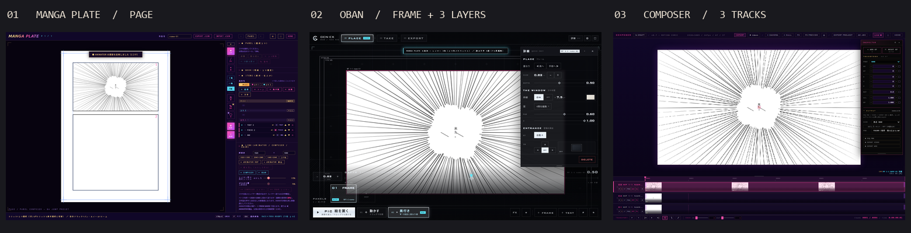

# タブ間連携の実機検証と申し送り

2026-11-03 JST · GitHub master `67584d454ce30e61449260336c3fabd98ccdad76` を起点にした作業コピー。Windows、Chromium 149.0.7827.55（headless）、1500×970 CSS px。実行ごとに空のブラウザコンテキストとループバックの専用ポートを使用。外部フォントを遮断。入力・送受信・Undo は通常の画面操作で行い、寸法・画像更新・階層は開いているアプリの実データとも照合した。下図は実画面の縮小。MANGA は文字の戻し後、OBAN と COMPOSER は初回受信時。

## 再現した問題と修正

| 操作 | 元の版 | この作業コピー |
|---|---|---|
| 上段コマを選び、ANIMATOR の絵を取り込む | IMG は正しいコマの子だが、コマ中心 Y=1796.41 に対しページ中心 Y=3779.5 に置かれた。枠外に描いた部分はマスクで見えない | 中心 (2716.5, 1796.41)、倍率 2.07617。LIVE で新しい線が届いたあとも同じ位置、1件 |
| 取込直後に Ctrl+Z | IMG が残って Y だけ戻る。追加・画像情報・配置が別々の履歴になっていた | 1回で IMG が0件。Ctrl+Y で同じコマの同じ位置に1件復帰 |
| OBAN の ⚙ → FILE／連携 → ▶ANIMATOR → 候補を押す | 一覧は生成されたが、手前の設定画面がクリックを受け取っていた。旧版は設定の「✕」を押せば先へ進める | ボタンから直接一覧へ移り、候補を1回押して取り込めた。処理停止やタブのクラッシュは観測していない |

MANGA の原因は `addItem` が追加先のコマから計算した座標・倍率を、旧 `placeLinked` が控えなしの場合に `PAPER.bas` で上書きしていたこと。現行の `addItem` / `addImage`（manga-plate.html 2222、2262行付近）は画像情報・既知の戻り先を揃えてから1回だけ履歴に積む。既存の控えに一致する場合はそのページ・コマへ追加する。OBAN は `#b-ap`（oban-builder.html 2047行付近）の設定画面から一覧への遷移だけを変更。受信通知にはページ、コマ、解像度、コマ数、奥行き、Undo 操作を表示する。

## Claude Code → Codex 再現手順

1. **検証場所を分ける。** コピーのルートで `python -m http.server 0 --bind 127.0.0.1` を実行し、表示されたポートの `/link-map.html` を新規のテスト用ブラウザプロファイルで開く。以下はすべて同じプロファイル・同じ URL の方式／ホスト／ポートから開く。既存作品の IMPORT、CLEAR、DB 初期化は不要。
2. **閉じた相手と再送。** 連携マップの ROUGH → ANIMATOR REF から ROUGH だけを開き、中央に線を描いて送る。「共有DBに置きました」を OK で閉じてからマップで ANIMATOR を開く。REF に ROUGH が1件入る。ROUGH で離れた場所にもう1本描いて再送する。「差し替えました」と表示され、同じ REF 1件・不透明度50%のまま。実体は IndexedDB `tdr_exchange.projects`、閉じている間の通知は `tdr_ref_inbox`、開いているタブの通知は `tdr_live`。
3. **下敷きの往路。** マップで MANGA PLATE を開き、B4 の既定ページを DIV で横に割り、SEL で上段を選ぶ。実測の上段は約4252×2412用紙px。◆Link → ▶ ANIMATOR REF、確認画面で新しいタブを開かず、既存の ANIMATOR で REF → **+ SAVED** → **MP 1-1 name-01** を選ぶ。画像参照として 1920×1080 が表示される。ROUGH と異なり、MANGA の下敷きは一覧から選ぶ操作が必要。
4. **作画の復路と再送。** ANIMATOR の REF パネルを閉じ、2048×1152 の作画面中央に線を描き、LIVE。MANGA で元のコマを選び、◀ ANIMATOR 取込 → 2048×1152 の作画プロジェクトを選ぶ。ROUGH も候補に出るので名前と寸法を見る。線を加筆すると IMG の画像データだけが更新された。MANGA で Ctrl+Z → Ctrl+Y。表の件数・位置を確認する。**「取込」をもう一度押す操作は新規追加**。すでに置いた絵の更新には送信側の LIVE を使う。
5. **レイヤーと文字。** 同じコマに集中線を足し、◆Item で手前／ぱかぱか ON（3種・2コマ打ち）、文字「来た。」を追加。コマを選び直し、▶▶ COMPOSER レイヤーと ▶▶ OBAN レイヤーを順に送る。COMPOSER は直に3トラック。OBAN は ⚙ → ▶ANIMATOR → MP 1-1 を選び、1フレーム・子3枚・編集可能な文字1件。COMPOSER は文字を画像に焼く。
6. **OBAN から返す。** フレームをダブルクリックして内部へ入り、文字をダブルクリック。「着いた。」に変え Ctrl+Enter。両タブを開いたまま、MANGA の通知と原稿を確認。Ctrl+Z で「来た。」、Ctrl+Y で「着いた。」。自動保存後に MANGA を再読み込みし、文字と3素材の配置が復元された。
7. **縦長の別ケース。** 別の空のテスト環境で紙を縦に割り、約2205×6378のコマを選び、手順3・4を繰り返す。1920×1080 下敷きの画素使用率は **19%**。通常取込はコマ中心 (1693.18, 3779.5) に、横長2048×1152の画像全体を **2205×1241** に収めた。縦横比とコマ割当は正しいが、下敷きの余白まで含めて縮む。コマ全面を使いたいときは作画開始前に MANGA の「コマ比」で出力寸法を決め、空の ANIMATOR 作画面もその寸法に揃える。既存原稿のキャンバスサイズ変更はこの検証の対象外。

## サイズ・順序・座標の読み方

| 同じ上段コマから送ったもの | 実際の値 |
|---|---|
| MANGA の枠／のりしろ | 枠 1670×947 px。115% のりしろ付き画像は1920×1089 px。ページに指定した1920×1080とレイヤー出力寸法は用途が異なる |
| COMPOSER | 1920×1089、24fps、6f、3トラック。地・中間の画像は1920×1089、手前は実PNG 1344×762（70%）を1920×1089扱い。読み込み直後の Z は3本とも0。自動で視差が付くという案内を修正 |
| OBAN | 枠の縦横比1.763、Z=1。地／中間／手前の DEPTH は0／0.5／0.85。子はすべて枠中心 (0,0)、高さ1.15。文字アンカーはのりしろを除く枠の高さで正規化。文字の往復は文字列だけ |
| 復路の識別 | MANGA の下敷きには `mp_…`、ANIMATOR の作画には別の projectId。MANGA の通常候補は `mp_` を除外する。REF を読み込んだだけで、そのIDが作画の戻り先になる仕組みは確認できない |

## 次に実装する受け渡し契約（提案）

**最初の変更は「元のコマに戻す」を明示できること。** 既存の PROJECT_v1/v2 に任意の `transfer` を追加する。初回に送ったコマの控えを、新しく作画した projectId でも参照できるようにする。タイトルを記号・英数字に縮めて作る現行キーは、日本語だけの別冊が同じページ番号・コマ番号で衝突し得る。安定した bookId/pageId/panelId を発行し、旧データは読み取り時に扱う。

| 情報 | 送る値と受け側の約束 |
|---|---|
| 識別 | transferId、revision、送り元アプリ、作画 projectId、returnTo（bookId/pageId/panelId/layerId）。同じ transferId・revision の再通知は1回だけ適用。元ページがなければ追加先を選ぶ |
| 幾何 | 左上原点、右＋X・下＋Y。用紙座標の枠、のりしろ込み矩形、論理 W/H、実PNG W/H、contain の倍率と左右上下の余白。REF を途中で動かしたらその変換も記録し、返却時は記録した変換の逆を使う |
| 層・時間 | layerId、親、奥→手前の順、奥行き、文字を焼くか編集可能か、fps と各セルの保持コマ数。70%画像は画質だけに適用。OBAN の DEPTH と COMPOSER の Z は単位が違うので変換規則を別に持つ |
| 保存・通知 | 画像と manifest を同じ版として確定してから通知。受信側はDBから取得・デコード・適用し、その後に transferId と revision 付き ACK。重複や古い通知は件数を増やさない。通知が来なくても一覧から最新版を取り直せる |

**受信画面は一行で判断できる形にする。** 例「P1 コマ2・手前 ← ANIMATOR｜作画2048×1152 → 縦コマ2205×6378｜等比・上下に余白」。その下にコマ枠・のりしろ・絵の小さな重ね見本。初回は「このコマに配置」、同じリンクは「絵だけ更新」を既定にし、「別素材として追加」は別操作にする。送信側は「共有DBに保存済み」「相手待ち」「受信済み」「読込失敗」を区別する。待機中は「相手を開く」「保存済みから拾う」、失敗時は同じ版の「再送」を出す。受信側では直前の受信だけを1回の Undo で戻す。

**引き継ぎ時の受入条件。** 縦コマ四隅に目印を置き、1920×1080 とコマ比の両方、のりしろ100/115%、手前PNG 70/100% で往復。元枠と4点を用紙上の同じ倍率で比較し、誤差1論理px以内、親・層・順序・保持コマ数が一致すること。同じ版の再送2回で件数不変、古い版の遅着で巻き戻らないこと。受信側を閉じる、読込失敗、再読込、別冊の同名コマでも確認する。旧 PROJECT_v1/v2 は今までどおり開けること。

**未検証の境界。** 長時間の固まり、端末メモリ不足、DB容量超過、Safari/iPad、別ブラウザ間のファイル受け渡し、TAKE再生中の視差、出力動画の画素一致は未検証。コード上は `refInboxCheck` が読込完了前に ACK を返し、OBAN の `plateLayers` は欠けた子をスキップする。誤って「受信済み」と表示する条件として、次の障害試験に分ける。LIVE画像の版ごとの Undo も今回の「取込1回の Undo」とは別課題。

